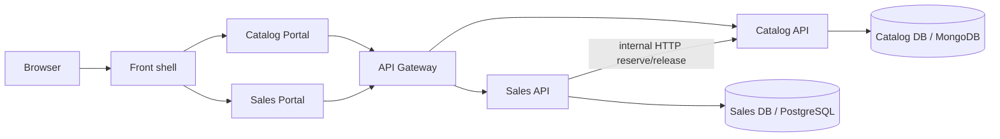

# Trazabilidad de integración real

## Flujo disponible en los repositorios oficiales

Catalog es dueño de inventario y Sales es dueño de pedidos. Sales llama los
endpoints internos de Catalog para reservar o liberar stock; el Gateway sólo
debe publicar rutas públicas. No existe acceso de Sales a MongoDB de Catalog.

## Script E2E identificado

`amaranta-shop-sales-portal/scripts/e2e-real-stack.sh` puede construir un stack
de demostración con PostgreSQL, MongoDB, migraciones Flyway/Liquibase, Sales API,
Catalog API, Gateway, shell y ambos portales. Su verificación cubre checkout,
idempotencia, caída de stock, reglas de negocio y propagación de
`X-Correlation-Id`.

### Prerrequisitos

1. Los siete repositorios vecinos o sus rutas en `SALES_DB_DIR`, `SALES_API_DIR`,
   `CATALOG_DB_DIR`, `CATALOG_API_DIR`, `GATEWAY_DIR`, `FRONT_DIR` y
   `CATALOG_PORTAL_DIR`.
2. Docker Desktop con acceso a los registros de imágenes.
3. Puertos locales 4200, 4201, 4202 y 8000 disponibles.
4. Gateway, Front y Catalog Portal promovidos a `develop`, porque hoy su código
   está únicamente en ramas de funcionalidad.

### Estado

**REAL E2E AVAILABLE: NO para un release candidate actual.** El script existe,
pero no se ejecutó: Docker Desktop no puede resolver su registro de imágenes y
las ramas `develop` de los componentes de ensamblaje todavía no contienen el
código requerido. No se debe presentar el script como evidencia de una corrida
completada hasta resolver ambos puntos.

## Próximo trazo

1. Revisar y promover `feat/catalog-routes` a `develop` del Gateway.
2. Revisar y promover `feat/sales-routes` a `develop` del Gateway.
3. Promover los incrementos mínimos de Front y Catalog Portal que necesita el
   script E2E.
4. Resolver conectividad Docker y ejecutar `up`, `check` y `down`.
5. Conservar logs, SHAs e imágenes como evidencia del primer stack real.
