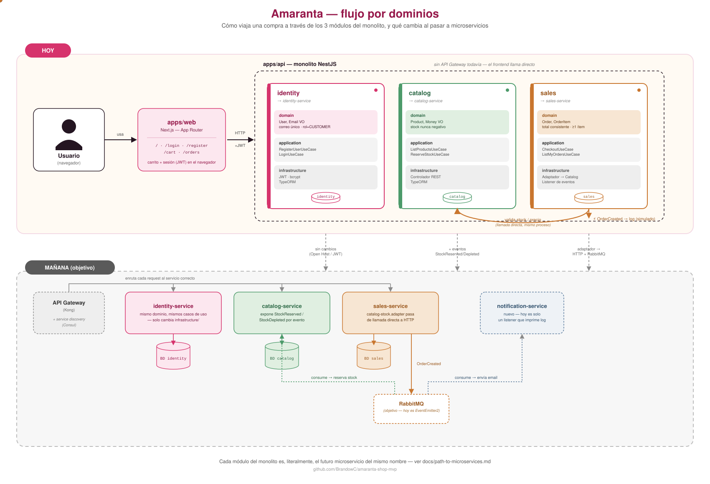

# Amaranta — Final project, Corte 3

## Release statement

`v3.0.0` is the operational baseline that can be built and demonstrated from this
repository. It combines the Amaranta NestJS application with an independent,
network-accessed Catalog service. The purpose of this release is to demonstrate
the real extraction boundary without presenting planned components as completed.

The validated composition is `docker-compose.distributed.yml`. No public deployment
URL is claimed for this release; the supported target is a local Docker environment.
The presentation used for the oral delivery is
[`deliverables/amaranta-c3-v3.0.0-presentation-final.pptx`](../deliverables/amaranta-c3-v3.0.0-presentation-final.pptx).

## System architecture



```text
Browser or API client
        |
        v
Amaranta API (NestJS, :8083) ---- HTTP + x-correlation-id ----> Catalog API (Python, :8082)
        |                                                               |
        v                                                               v
API PostgreSQL (:55435)                                            MongoDB (:27017)
        |
        v
Sales PostgreSQL (:55434, prepared persistence boundary)
```

The API contains the Identity, Catalog, Sales, Clinical, and Scheduling modules
with domain/application/infrastructure boundaries. The extracted Catalog service
owns its MongoDB connection and exposes versioned HTTP endpoints. The Sales-to-
Catalog dependency is an adapter and not a cross-database query.

### Implemented contracts and operational interfaces

| Interface | Evidence in repository | Operational purpose |
| --- | --- | --- |
| Amaranta API | `apps/api`, `GET /health`, `GET /api-docs` | Main application and OpenAPI UI |
| Catalog HTTP service | `amaranta-distributed/01-repositories/amaranta-shop-catalog-api`, `GET /v1/products` | Independent Catalog boundary |
| Catalog readiness | `GET /health/live`, `GET /health/ready` | Separates process liveness from MongoDB availability |
| Correlation header | `x-correlation-id` in Catalog HTTP server and Sales adapter | Request-level integration correlation |
| Persistence isolation | `api-db`, `catalog-mongo`, `sales-db` Compose services | Prevents direct shared database access |

The detailed migration decisions are recorded in
[`ADR-010`](adr/ADR-010-c2-distributed-release.md) and
[`ADR-011`](adr/ADR-011-sales-catalog-query-contract.md).

## Reproducible validation

Prerequisites: Docker Desktop with Compose, Node.js 20, and the local `.env` values
derived from `.env.example`. Never commit private keys or `.env` files.

```powershell
cd C:\path\to\amaranta
docker compose -f docker-compose.distributed.yml up --build -d
.\scripts\verify-c3.ps1

Set-Location apps\api
npm test -- --runInBand
npm run build

Set-Location ..\catalog
npm test
npm run build
```

Validation performed for this release:

| Check | Result |
| --- | --- |
| API unit/application suite | 8 suites, 42 tests passed |
| Independent Catalog suite | 11 tests passed |
| API and distributed Compose syntax | valid |
| `GET /health` on Amaranta API | 200 |
| `GET /health/ready` on Catalog API with MongoDB available | 200 |

## Live demonstration

1. Start the composition and run `scripts/verify-c3.ps1`.
2. Open `http://localhost:8083/api-docs` to show the published Amaranta API.
3. Request `http://localhost:8082/v1/products` with an `x-correlation-id` header.
   A valid empty collection is expected until an approved data load exists; do not
   invent production catalog data for the demo.
4. Show the separate containers and data stores:

   ```powershell
   docker compose -f docker-compose.distributed.yml ps
   ```

5. Demonstrate a real dependency failure by stopping only MongoDB:

   ```powershell
   docker compose -f docker-compose.distributed.yml stop catalog-mongo
   curl.exe --max-time 10 -i http://localhost:8082/health/ready
   docker compose -f docker-compose.distributed.yml start catalog-mongo
   curl.exe -i http://localhost:8082/health/ready
   ```

   The readiness request returns `503` while MongoDB is down and returns `200`
   after the database restarts. MongoDB connection, selection, and socket checks
   have a two-second timeout so the health signal remains bounded.

## Handover and operations

| Need | Command or source |
| --- | --- |
| Start the runnable system | `docker compose -f docker-compose.distributed.yml up --build -d` |
| Inspect runtime | `docker compose -f docker-compose.distributed.yml ps` and `logs` |
| Stop only this composition | `docker compose -f docker-compose.distributed.yml down` |
| API contract | `http://localhost:8083/api-docs` while running |
| Catalog contract and tests | `amaranta-distributed/01-repositories/amaranta-shop-catalog-api` |
| Domain architecture | `docs/flujo-dominios.svg` and `docs/path-to-microservices.md` |
| Change history | `CHANGELOG.md` |

## Known limitations and next decisions

The release is runnable, tested, and has a genuine inter-service Catalog boundary,
but it is not a claim of a completed production microservice platform. The following
items are intentionally outside `v3.0.0`:

1. The autonomous Sales API and its persisted Saga state are not yet runnable.
2. RabbitMQ, durable outbox, idempotent inbox, DLQ, and worker are not yet present
   in the runtime composition.
3. Full metrics export, traces, alert delivery, and a public deployment remain
   future operational work.

These limitations are recorded so that the demo, presentation, and oral defense
can explain the implemented value and the next engineering increment precisely.
